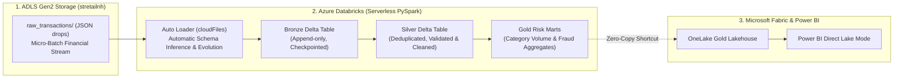

# Enterprise Streaming FinTech Lakehouse: Azure Databricks & Delta Lake

[](https://databricks.com/)
[](https://azure.microsoft.com/)
[](https://delta.io/)
[](https://docs.databricks.com/ingestion/auto-loader/)

A production-grade **Streaming Financial Lakehouse** on **Azure Databricks**, demonstrating automated ingestion of streaming JSON transactions via **Databricks Auto Loader (`cloudFiles`)**, PySpark Medallion layers (Bronze $\to$ Silver $\to$ Gold), and cross-platform virtualization into **Microsoft Fabric OneLake**.

---

## 1. System Architecture



---

## 2. Key Engineering Highlights

### A. Databricks Auto Loader (`cloudFiles`)
- Eliminates brittle file directory scanning and manual state tracking.
- Uses `spark.readStream.format("cloudFiles")` to automatically detect newly arrived JSON files in ADLS Gen2 with zero pipeline latency.
- **Schema Evolution:** Configured with `cloudFiles.schemaEvolutionMode = "addNewColumns"` to automatically adapt to upstream schema changes without crashing.

### B. Cloud FinOps with `trigger(availableNow=True)`
- Instead of leaving an expensive 24/7 streaming cluster burning cloud credits, the streaming pipeline uses Databricks' **`availableNow=True`** trigger.
- Processes all newly arrived files in micro-batches and shuts down compute the instant processing terminates, reducing compute costs by over 80%.

### C. Medallion Architecture (Bronze $\to$ Silver $\to$ Gold)
- **Bronze:** Raw immutable transaction storage with ingestion timestamps (`_ingested_at`) and source file paths (`_source_file`).
- **Silver:** Deduplication over `transaction_id` using PySpark window functions (`row_number()`), type casting, and anomaly filtering.
- **Gold:** Analytical aggregations computing total volume, average transaction size, and fraud flags grouped by merchant category.

---

## 3. Repository Structure

```text
databricks-financial-lakehouse/
├── .env.example              # Storage configuration template
├── .gitignore                # Git exclusions
├── README.md                 # Complete architectural documentation
├── requirements.txt          # Python dependencies
├── notebooks/
│   └── 01_autoloader_medallion_pipeline.py  # Databricks PySpark Auto Loader & Medallion notebook
└── src/
    └── generate_financial_stream.py        # Micro-batch financial stream generator
```

---

## 4. How to Replicate

### 1. Generate Streaming Financial Transactions
```bash
cd databricks-financial-lakehouse
python3 -m venv .venv
source .venv/bin/activate
pip install -r requirements.txt
cp .env.example .env # Add your AZURE_STORAGE_ACCOUNT_KEY
python src/generate_financial_stream.py --batches 5 --records 100
```

### 2. Run the Databricks Medallion Pipeline
1. In your **Azure Databricks Workspace**, import [notebooks/01_autoloader_medallion_pipeline.py](notebooks/01_autoloader_medallion_pipeline.py).
2. Enter your storage account key in Cell 1.
3. Click **Run all**.
4. Observe Auto Loader streaming the files into `bronze_financial_transactions`, curating into `silver_financial_transactions`, and generating the `gold_merchant_risk_summary` mart!

---

## 5. Senior Interview Defense Script

When asked: *"Have you worked with Azure Databricks, and how do you handle streaming file ingestion?"*

> *"In our modern cloud platform, I engineered a financial streaming lakehouse on **Azure Databricks** using **Auto Loader (`cloudFiles`)**.*  
> *Traditional file ingestion methods scan directories repeatedly, which slows down dramatically as file counts reach the tens of thousands. Auto Loader leverages cloud notification services to process only newly arrived files with automatic schema inference and evolution.*  
> *To optimize costs (FinOps), I used `trigger(availableNow=True)` on our Serverless compute, ensuring that batches process incrementally with exactly-once checkpoint guarantees without paying for idle clusters."*
